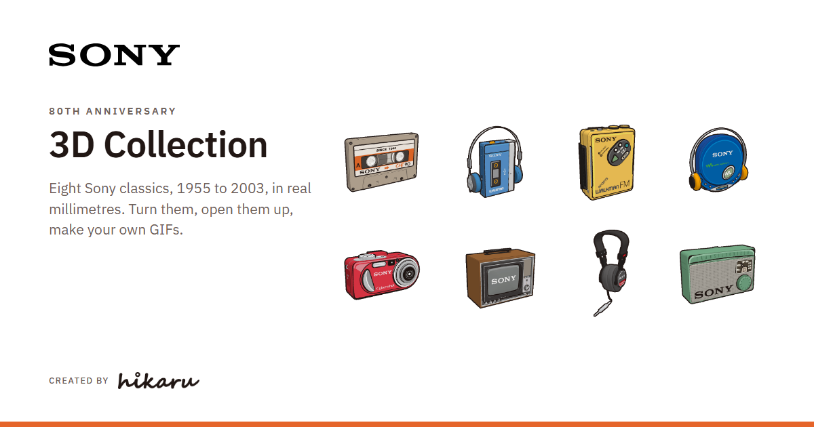

# Sony 80th Anniversary · 3D Collection

**By [Hikaru Digital Marketing](https://www.hikaru.com.tw/) (光曜町數位行銷有限公司)**

Eight Sony classics, from the 1955 TR-55 radio to the 2003 Cyber-shot DSC-P8, rebuilt as 3D models in real
millimetres and dressed in the Sony 80th-anniversary illustration. Each one opens up to show its inside, rebuilt from
service manuals and photos. Turn them, light them, play them as a showcase, or make your own GIFs.

**[Open the collection](https://hikaru-tw.github.io/sony80-3d-collection/)** ·
[GIF gallery](https://hikaru-tw.github.io/sony80-3d-collection/output/gifs/) ·
[Cassette viewer](https://hikaru-tw.github.io/sony80-3d-collection/output/chf90_viewer.html)

## The 8 products

| id | Product | Size used (mm) | Opens up to show |
| --- | --- | --- | --- |
| `chf` | Sony Tape CHF 90 (1980 illustration) | 100.4 x 63.8 x 12 | the reels, tape path, rollers and pressure pad |
| `tps-l2` | Walkman TPS-L2 + MDR-3L2 headphones (1979) | player 88 x 133.5 x 29 | the 1979 mechanism and its boards |
| `wm-f5` | Sports Walkman WM-F5 (1983) | 100.4 x 125.2 x 42.1 | the cassette, deck and radio board |
| `d-e350` | CD Walkman D-E350 + headphones (2002) | 130.6 x 150.5 x 26.3 | the CD and the pickup |
| `dsc-p8` | Cyber-shot DSC-P8 (2003) | 108 x 51.5 x 35.1 | the lens block, flash and board |
| `kv-1310` | Trinitron KV-1310 (1968) | 451 x 362 x 397 | the Trinitron tube, yoke, boards and wiring |
| `mdr-cd900st` | MDR-CD900ST headphones (1989) | cups 72 x 83, measured on photos | the 40 mm drivers |
| `tr-55` | TR-55 transistor radio (1955) | 140 x 89 x 38 | the 1955 chassis, cells and circuit label |

Where each size and detail comes from is written at the top of `render/products/<id>.js`.

## The site

`index.html` is the whole collection in one self-contained page (three.js, the models and their textures bundled in;
it works offline too). Pick a product from the strip or with ← →, drag to orbit, scroll to zoom, and press Inside to
open it up.

- **3D / GIF** (G): the switch at the end of the product strip shows each product's GIF from the set instead of the
  model, pixel or smooth, with a download link and the full gallery one click away.
- **Showcase** (S): only the product, playing a loop (or its GIF), with its name, year and size; it steps through the
  eight.
- **Adjust** (C), in four tabs: View (zoom, lens, ground, outline), Light (presets and the key light), Motion (sway,
  turntable or open-up loop, frames, delay, showcase timing) and Export.
- **Export**: make a GIF or PNG of the current view, or all eight as a .zip, at 250 / 500 / 1000 px, pixel or smooth,
  transparent or on the ground colour. At the default view it matches the GIF set.

Keys: 1-7 views, I inside, + / - zoom, R reset, P play loop, S showcase, G 3D / GIF, F fullscreen, C the panel. `#kv-1310` (or
any product id) in the address opens that product.

## Build it yourself

Everything is generated from the code in `render/`; see `render/README.md` for every option and the notes on each
model.

    cd render
    npm install                                                  # three.js
    pip install playwright pillow numpy scipy
    python -m playwright install chromium
    python make_gifs.py              # the 16 GIFs in output/gifs/ and the contact sheet (or: make_gifs.py tps-l2 kv-1310)
    python make_social.py            # output/social.png, the link preview
    python build_viewer.py           # index.html (the site), output/chf90_viewer.html and the GIF gallery page
    python render2.py mode=hero id=kv-1310 explode=1 out=kv_open   # one still, opened up (-> kv_open.png)

`prep_products.py` cuts the face art from the master illustration into `reference image/illustrations/` and
`render/tex/`; the cut PNGs are included, so it only needs running if the illustration changes. The reference photos
and manual scans the models were measured against stay private (third-party rights), so `compare.py` and `refs.py`,
the scripts that check the models against them, are not part of this repository.

## Layout

| Path | What |
| --- | --- |
| `index.html` | the site: the 8-product viewer |
| `render/kit.js`, `render/products/*.js`, `render/cassette.js` | the models, one module per product |
| `render/product.html`, `render/model.html` | headless render pages with the ink-outline pass |
| `render/*.py` | GIF, still, preview-image and viewer builders |
| `render/tex/`, `render/*.png` | textures |
| `render/brand/` | the Sony and Hikaru logos used in the pages' headers |
| `render/gallery_src.html` | source of the GIF gallery page |
| `output/gifs/` | the GIF set: `<id>_pixel.gif`, `<id>_smooth.gif`, contact sheet, gallery page |
| `output/chf90_*` | the cassette's own renders, GLB and viewer |

## Credits and licence

Made by Hikaru Digital Marketing. Face art: the Sony 80th-anniversary illustration, used with permission. Sony,
Walkman, Trinitron, Cyber-shot and the product names are trademarks of Sony Group Corporation or its affiliates.
See [CREDITS.md](CREDITS.md) for the sources and tools.

The source code is released under the [MIT licence](LICENSE). The illustration, the textures cut from it, and the
renders, GIFs and 3D files made with it are not covered by that licence; see LICENSE for the details.
